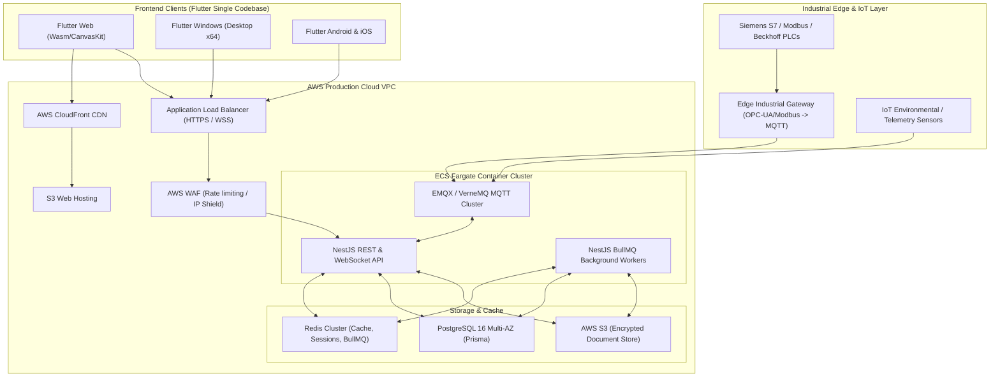
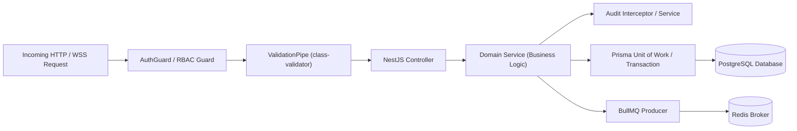

# Master Implementation Plan: Production-Grade Company ERP Platform

## 1. Project Overview
The Company ERP Platform is a multi-platform, industrial-grade Enterprise Resource Planning system with integrated Industrial IoT / PLC telemetry, SCADA monitoring, supply chain, manufacturing, financials, and CRM. 

The system is architected as:
- **Unified Client Application**: Cross-platform Flutter client supporting Web, Windows Desktop, Android, and iOS from a single robust codebase.
- **Authoritative Backend**: NestJS modular micro-service/monolith backend enforcing all domain validation, security, RBAC, background jobs (BullMQ + Redis), and audit trails.
- **Relational Data Tier**: PostgreSQL with Prisma ORM guaranteeing ACID transactions, audit logging, soft-deletes, and strict referential integrity.
- **Industrial Real-Time & IoT Subsystem**: Edge Gateway integration via MQTT broker (EMQX / Mosquitto), bi-directional WebSocket gateways, PLC safety interlocks, and telemetry ingestion pipeline.
- **Enterprise Cloud Infrastructure**: AWS ECS Fargate, RDS Multi-AZ, S3 signed object storage, CloudFront, Route 53, Redis ElastiCache, WAF, CloudWatch monitoring, and GitHub Actions CI/CD.

---

## 2. System Architecture & Topology



---

## 3. Technology Stack

| Layer | Technologies | Key Libraries / Frameworks |
|---|---|---|
| **Frontend UI** | Flutter 3.x, Dart 3.x | Riverpod 2.x (State), GoRouter (Declarative Routing), Dio (HTTP/Interceptor), Freezed & json_serializable, Drift (Offline SQLite), Flutter Secure Storage, web_socket_channel, fl_chart |
| **Backend API** | Node.js 20 LTS, TypeScript 5.x | NestJS 10.x, Prisma ORM 5.x, BullMQ, Redis (ioredis), Socket.io / WebSocket, class-validator, class-transformer, Passport JWT, Helmet, Winston logger |
| **Industrial / Realtime** | MQTT 5.0, WebSockets | MQTT.js, EMQX Broker, Modbus-TCP / OPC-UA bridge adapters |
| **Database & Cache** | PostgreSQL 16, Redis 7 | TimescaleDB / partitioned tables for telemetry, Prisma Migrations |
| **DevOps & Cloud** | Docker, AWS, GitHub Actions | Terraform / CloudFormation, AWS ECS Fargate, RDS PostgreSQL, S3, CloudFront, ECR, Route 53, CloudWatch |

---

## 4. Repository Structure

```
company-erp_FINAL/
├── .github/
│   └── workflows/                # CI/CD pipelines (Lint, Test, Build, Deploy)
├── backend/                      # NestJS Production Backend
│   ├── prisma/                   # Schema, migrations, seeders
│   ├── src/
│   │   ├── common/               # Guards, interceptors, filters, decorators, pipes
│   │   ├── config/               # Environment & configuration modules
│   │   ├── database/             # Prisma service, transactions
│   │   ├── modules/              # Feature modules (Auth, Users, CRM, Inventory, IoT, etc.)
│   │   │   ├── auth/
│   │   │   ├── rbac/
│   │   │   ├── organization/
│   │   │   ├── crm/
│   │   │   ├── sales/
│   │   │   ├── finance/
│   │   │   ├── inventory/
│   │   │   ├── manufacturing/
│   │   │   ├── quality/
│   │   │   ├── maintenance/
│   │   │   ├── hr/
│   │   │   ├── iot/
│   │   │   ├── plc/
│   │   │   └── ...
│   │   └── main.ts
│   ├── test/                     # e2e & integration test suites
│   ├── Dockerfile
│   └── package.json
├── frontend/                     # Flutter Multi-Platform Client
│   ├── lib/
│   │   ├── core/                 # Design system, themes, network client, storage, router, utils
│   │   │   ├── theme/            # Colors, typography, spacing, component themes
│   │   │   ├── network/          # Dio client, interceptors, auth tokens, error handlers
│   │   │   ├── router/           # GoRouter route graph, guards, redirects
│   │   │   ├── storage/          # Secure storage, Drift offline DB
│   │   │   ├── realtime/         # WebSocket & Telemetry client
│   │   │   └── widgets/          # Atomic enterprise UI components (Tables, Cards, Modals, Forms)
│   │   ├── features/             # ERP Module Features (Clean slice: domain, data, presentation)
│   │   │   ├── auth/
│   │   │   ├── dashboard/
│   │   │   ├── crm/
│   │   │   ├── sales/
│   │   │   ├── finance/
│   │   │   ├── inventory/
│   │   │   ├── manufacturing/
│   │   │   ├── quality/
│   │   │   ├── maintenance/
│   │   │   ├── hr/
│   │   │   ├── iot/
│   │   │   ├── plc/
│   │   │   └── ...
│   │   ├── mock/                 # ISOLATED Demo/Mock Data Sources for UI-First phase
│   │   └── main.dart
│   ├── test/                     # Unit, Widget, Goldens & Provider tests
│   └── pubspec.yaml
├── docs/                         # Architecture, Specs, Manuals, Tracking
│   ├── 00_MASTER_REQUIREMENTS.md
│   ├── IMPLEMENTATION_PLAN.md
│   ├── MODULE_DEPENDENCY_MATRIX.md
│   ├── DEVELOPMENT_TRACKER.md
│   └── architecture/
└── docker-compose.yml            # Local development orchestration (Postgres, Redis, EMQX)
```

---

## 5. Flutter Architecture (Clean Feature-First)

```mermaid
flowchart TD
    subgraph FeatureModule["Feature Module (e.g., Inventory)"]
        subgraph Presentation["Presentation Layer"]
            Screen["Responsive Screens (Desktop/Mobile/Web/Windows)"]
            Widgets["Feature-Specific Widgets (Forms, Tables, Detail Cards)"]
            Controllers["Riverpod StateNotifiers / AsyncNotifiers"]
        end

        subgraph Domain["Domain Layer"]
            Models["Immutable Domain Entities (Freezed)"]
            RepoInterface["Repository Interface"]
        end

        subgraph Data["Data Layer"]
            ProdRepo["Production API Repository (Dio)"]
            MockRepo["Development Mock Repository (Demo Data)"]
            LocalCache["Drift / SQLite Local Cache"]
        end
    end

    Screen --> Controllers
    Widgets --> Controllers
    Controllers --> RepoInterface
    RepoInterface <|.. ProdRepo
    RepoInterface <|.. MockRepo
    ProdRepo --> LocalCache
```

- **State Management**: Riverpod (`AsyncNotifierProvider`, `StateNotifierProvider`, `AutoDispose`).
- **Routing**: `GoRouter` with nested shell routes (Desktop Sidebar Navigation Rail vs Mobile Adaptive Navigation Bar/Drawer).
- **Network**: Dio with automatic token refresh interceptor, request correlation IDs, retry policies, and structured error parsing.
- **Design System**: Strict design tokens (`AppColors`, `AppTypography`, `AppSpacing`, `AppElevations`, `AppRadius`) adhering to enterprise SaaS standards.

---

## 6. Backend Architecture (NestJS Modular Layered)



- **Validation**: Strict DTOs with `whitelist: true`, `forbidNonWhitelisted: true`, `transform: true`.
- **Transactions**: Explicit `prisma.$transaction()` for financial, inventory, BOM consumption, and state change workflows.
- **Error Handling**: Global `HttpExceptionFilter` producing uniform RFC 7807 problem details.
- **Audit Logging**: Automatic audit trail interceptor logging actor, entity, action, before/after diffs, and IP/request IDs.

---

## 7. Database Strategy & PostgreSQL Schemas

1. **Multi-tenant / Organization scoped**: Every transactional entity includes `organizationId` and `plantId` where applicable.
2. **Auditing Fields**: Every table contains `createdAt`, `updatedAt`, `createdById`, `updatedById`, `deletedAt` (soft-delete).
3. **Optimistic Locking**: Version column (`version Int @default(1)`) on critical assets (inventory items, work orders, invoices).
4. **Partitioning**: Telemetry and Audit Log tables partitioned by month/year or time-series buckets.
5. **Foreign Key Integrity & Constraints**: Strict `ON DELETE RESTRICT` for primary business records to avoid orphan data.

---

## 8. API Strategy & Standards
- **REST Endpoints**: `/api/v1/<resource>`
- **HTTP Verbs**: `GET` (read), `POST` (create), `PATCH` (partial update), `PUT` (full replacement), `DELETE` (soft/hard delete).
- **Pagination**: Uniform cursor and limit-offset pagination:
  ```json
  {
    "data": [],
    "meta": { "page": 1, "limit": 20, "total": 1420, "totalPages": 71, "hasNext": true }
  }
  ```
- **Filtering & Sorting**: `?filter[status]=ACTIVE&sort=-createdAt`
- **Correlation ID**: `X-Correlation-Id` header passed and logged across all requests and events.
- **API Documentation**: Live Swagger/OpenAPI generated automatically at `/api/docs`.

---

## 9. Authentication Strategy
- **Tokens**: Dual-token JWT architecture:
  - Short-lived Access Token (15 minutes).
  - Long-lived HttpOnly Refresh Token (7 days) stored securely in Redis session store.
- **MFA / 2FA**: TOTP (Time-based One-Time Password) support for administrative, financial, and machine command roles.
- **Device & Session Management**: Tracking of active sessions, platform fingerprinting, and remote revocation.
- **Secure Storage**: Flutter clients store tokens via `FlutterSecureStorage` (EncryptedSharedPreferences on Android, Keychain on iOS/macOS, DPAPI on Windows).

---

## 10. Role-Based Access Control (RBAC) & Permissions
- **Granular Permissions Matrix**: Formatted as `<domain>:<resource>:<action>` (e.g., `inventory:stock:adjust`, `plc:command:execute`, `finance:invoice:approve`).
- **Hierarchy**:
  - Super Admin
  - Executive / Plant Manager
  - Department Manager (Sales, Procurement, Production, QA, Maintenance, HR)
  - Operations Engineer / Technician
  - Operator / Warehouse Staff
  - Auditor / Read-only
- **Evaluators**: Declarative `@RequirePermissions('inventory:stock:adjust')` guards on backend endpoints and matched in Flutter UI presentation helpers (`if (user.hasPermission(...))`).

---

## 11. UI/UX Strategy & Enterprise Design System

### Layouts & Adaptability
- **Desktop / Web (≥ 1024px)**: Collapsible Sidebar navigation, top app bar with global quick-search, alert indicator, notifications drawer, multi-tab data grids, split-screen master-detail views.
- **Tablet (600px - 1023px)**: Adaptive Navigation Rail, sliding side-sheets for details, optimized 2-column forms.
- **Mobile (< 600px)**: Bottom navigation bar, modal bottom sheets, swipeable cards, optimized single-column forms.

### Design Tokens
- **Theme Palette**: Deep slate enterprise dark/light (`#0F172A`, `#1E293B`, `#3B82F6`, `#10B981`, `#F59E0B`, `#EF4444`).
- **Data Density**: High-density data tables with sorting, sticky headers, column reordering, export to CSV/PDF, custom filtering pills.
- **States**: Every view implements explicit `LoadingSkeleton`, `EmptyStateView` (with call to action), `ErrorStateView` (with retry), and `UnsavedChangesGuard`.

---

## 12. Complete ERP Module List (All 49 Modules)

### A. Platform & Core (17 Modules)
1. **Authentication** (Login, Register, MFA, SSO, Password Reset)
2. **Users Management** (User directory, profiles, status, department allocation)
3. **Roles** (Role definition, hierarchy, assignments)
4. **Permissions** (Granular matrix, policy enforcement)
5. **Organization** (Multi-company, branch, plant, cost center management)
6. **Master Data** (Currencies, units of measure, country codes, tax rules)
7. **Global Dashboard** (Executive, Operations, Finance, Machine KPIs)
8. **Notifications** (In-app, push, email, SMS notification center)
9. **Audit Logs** (Immutable system activity, compliance tracking)
10. **Document Management** (S3 storage, versioning, access control, previews)
11. **Global Search** (Omni-search across entities and documents)
12. **Reports Engine** (Custom report builder, scheduled exports)
13. **Administration** (System settings, feature flags, licenses)
14. **System Health** (Service status, memory, database, queue latency)
15. **Backup & Recovery** (Automated snapshots, backup verification, restore triggers)
16. **Import & Export** (CSV/XLSX bulk data processing, schema mapping)
17. **Integration & API Management** (Webhooks, API keys, third-party connectors)

### B. Business & Operational Modules (17 Modules)
18. **CRM** (Pipelines, customer interactions, activity timeline)
19. **Customers** (Customer master, credit limits, contacts, addresses)
20. **Leads** (Lead scoring, conversion, assignment, stage tracking)
21. **Quotations** (Cost estimation, multi-currency quotation, approval flows)
22. **Sales** (Sales orders, dispatch notes, order tracking)
23. **Finance & Accounting** (General ledger, chart of accounts, journal entries)
24. **Invoicing & Payments** (AR/AP, payment matching, aging reports, tax invoices)
25. **Procurement** (Purchase requisitions, RFQs, vendor evaluations)
26. **Suppliers** (Vendor master, compliance, ratings, banking info)
27. **Purchase Orders** (PO lifecycle, approval matrix, delivery terms)
28. **Inventory Management** (SKU catalogue, reorder levels, valuation FIFO/Weighted)
29. **Warehouse & Locations** (Aisle/rack/bin tracking, multi-warehouse transfers)
30. **Stock Movement** (Inbound, outbound, internal transfer, adjustments)
31. **Products & Catalog** (Variants, serial tracking, batch/lot management)
32. **Bill of Materials (BOM)** (Multi-level BOM, revision control, scrap factors)
33. **Manufacturing Execution (MES)** (Routing, work centers, capacity planning)
34. **Supply Chain & Logistics** (Shipment tracking, freight, delivery challans)

### C. Industrial, Production, Quality & IoT (9 Modules)
35. **Production Planning & Orders** (Work orders, job scheduling, material issue)
36. **Quality Management** (Inspection plans, incoming QC, in-process QC, CAPA)
37. **Machine Monitoring** (Live machine state, OEE, downtime tracking, cycle times)
38. **Maintenance Management** (Preventive schedules, breakdown work orders, spares)
39. **IoT Device Management** (Sensors, telemetry nodes, device provisioning, firmware)
40. **MQTT Engine & Gateways** (Broker management, topics, payload parsing)
41. **PLC / SCADA Integration** (OPC-UA / Modbus tag mapping, live registers, alarms)
42. **Realtime Telemetry Dashboard** (High-frequency charts, gauges, heatmaps)
43. **Alerts, Rules & Safety Engine** (Threshold rules, escalation, hardware interlocks)

### D. People, Governance & Technical (6 Modules)
44. **HR & Personnel** (Employee directory, designations, onboarding/offboarding)
45. **Attendance & Leave** (Biometric sync, shift scheduling, leave approval)
46. **Payroll** (Salary structure, payslips, deductions, statutory compliance)
47. **Projects & Task Management** (Gantt charts, milestones, resource allocation)
48. **R&D & Engineering** (Product design, ECOs - Engineering Change Orders)
49. **Legal & Compliance** (Contracts, NDA tracking, statutory filings, audit readiness)

---

## 13. Module Dependencies & Dependency Graph
*(Detailed in [MODULE_DEPENDENCY_MATRIX.md](file:///d:/saark/company-erp_FINAL/docs/MODULE_DEPENDENCY_MATRIX.md))*

```
Level 0: Auth -> Users -> Roles -> Permissions -> Organization -> Master Data
Level 1: Audit, Notifications, Documents, System Health
Level 2: Customers, Suppliers, Products, Warehouses, Chart of Accounts
Level 3: Leads, CRM, Inventory/Stock, BOM, Employees, IoT Devices, PLCs
Level 4: Quotations, Purchase Orders, Work Centers, Routing, Attendance
Level 5: Sales Orders, Goods Receipt, Work Orders, Inspections, Machine Monitoring
Level 6: Invoices, Material Issue/Receipt, Maintenance Orders, Telemetry & Alerts
Level 7: Payments, Financial Reports, Production Completion, CAPA, Machine Commands
Level 8: Executive Dashboards, Analytics, Payroll, Audit Clearance
```

---

## 14. Frontend-First Implementation Plan (Track A)
1. **Design System & Foundation**:
   - Create theme tokens, typography, colors, responsive breakpoints.
   - Build reusable widgets: `EnterpriseDataTable`, `MetricCard`, `FormSection`, `StatusBadge`, `ConfirmationDialog`, `SkeletonLoader`, `EmptyState`, `SearchFilterBar`.
2. **Navigation Shell & Layouts**:
   - Set up `GoRouter` shell routes supporting dynamic desktop sidebar and mobile adaptive drawer/bottom bar.
   - Implement breadcrumbs, quick search modal, profile menu, notification flyout.
3. **Mock Data Provider Layer**:
   - Create isolated `MockDataSource` and `DemoRepository` implementations for each feature module.
   - Guarantee that demo data is completely separate from future production API repositories.
4. **Build Complete Screens for All 49 Modules**:
   - Every module contains: Dashboard/List View, Detail View, Create/Edit Form, Filter Drawers, Action Modals, and Status Badges.
   - Verify layout responsiveness across Desktop (1920x1080), Tablet (1024x768), and Mobile (390x844).

---

## 15. Module-by-Module Production Backend Plan (Track B)
1. Implement Phase 1: Foundation (Auth, RBAC, Org, Master Data).
2. Implement Phase 2: Platform Core (Audit, Notifications, Documents, System Health).
3. Implement Phase 3: CRM & Sales (Customers, Leads, Quotations, Sales Orders).
4. Implement Phase 4: Finance (Chart of Accounts, Journal, Invoices, Payments).
5. Implement Phase 5: Procurement & Vendors (Suppliers, Purchase Orders, Goods Receipt).
6. Implement Phase 6: Inventory & Warehouse (SKU, Stock Movements, Transfers, Adjustments).
7. Implement Phase 7: Manufacturing & BOM (BOM, Routing, Work Orders, Material Consumption).
8. Implement Phase 8: Quality & Maintenance (Inspections, Defects, CAPA, Preventive Schedules).
9. Implement Phase 9: People & Governance (HR, Attendance, Payroll, Projects, Legal).
10. Implement Phase 10: Industrial IoT, PLC, Telemetry & Alerts.

---

## 16. Database Implementation Plan
- Prisma migrations generated per module.
- Strict foreign key constraints with indexed lookup fields.
- Decimal precision (`Decimal(18, 4)`) for all financial amounts and inventory quantities.
- Seed data scripts for default system roles, super-admin, currencies, UOMs, and test plants.

---

## 17. Realtime & WebSocket Plan
- NestJS WebSocket Gateway namespace (`/telemetry`, `/alerts`, `/notifications`).
- Authenticated WebSocket handshake using JWT.
- Channel / Room scoping based on User Organization and active Machine/Plant view.
- Flutter `RealtimeService` managing automatic reconnection, backoff, and live/delayed/offline indicators.

---

## 18. MQTT Plan
- MQTT 5.0 broker deployment (EMQX).
- Topic hierarchy standard: `erp/{orgId}/plant/{plantId}/line/{lineId}/machine/{machineId}/{telemetry|status|alert|command}`.
- Payload standard: JSON with ISO-8601 UTC timestamp, gateway signature, and structured register values.
- Edge ingestion service validating payload schema before storing or broadcasting.

---

## 19. PLC Integration & Industrial Safety
- **Zero Direct Flutter-to-PLC Connection**: Flutter client communicates exclusively with NestJS Backend.
- **Safety Interlock Architecture**:
  1. Operator initiates command in Flutter UI (requires confirmation & MFA/PIN).
  2. Backend validates user permission (`plc:command:execute`), machine operational state, and active interlocks.
  3. Command logged to immutable audit table with timestamp, IP, and reason.
  4. Backend publishes command to secure MQTT control topic with time-to-live (TTL).
  5. Edge Gateway verifies physical safety permissives with PLC before register write.
  6. Hardware watchdog and PLC hardware interlocks maintain fail-safe state at all times.

---

## 20. Offline Sync Plan
- Offline data storage via Drift (SQLite).
- Sync Queue pattern: Local mutations queued with idempotency keys.
- Status Indicator: `LIVE`, `OFFLINE`, `SYNCING`, `SYNC_FAILED`.
- Conflict resolution strategy: Server timestamp wins with manual resolution fallback for inventory/financial conflicts.

---

## 21. Testing Strategy
- **Flutter**:
  - Unit tests for Riverpod notifiers and repositories.
  - Widget tests for critical design system components and module screens.
  - Mock API tests and integration tests.
- **Backend**:
  - Unit tests for domain services.
  - E2E tests for API controllers using Jest & Supertest.
  - Transaction rollback tests for financial and inventory operations.
  - RBAC security permission bypass tests.
- **Load & Realtime**:
  - Ingestion benchmarking for high-rate MQTT telemetry (1000 msgs/sec).

---

## 22. Debugging Strategy
- Strict Root Cause Analysis (RCA) on any failing build or bug.
- Centralized structured logging with Winston / CloudWatch.
- Request correlation IDs attached to every log and error response.

---

## 23. Security Strategy
- OWASP Top 10 compliance: SQL injection prevented by Prisma ORM, XSS prevented by Flutter/React sanitization, CSRF tokens, Helmet HTTP headers.
- Rate limiting on sensitive endpoints (`@nestjs/throttler`).
- Encrypted storage at rest (AWS KMS / RDS encryption) and in transit (TLS 1.3).
- Zero secret exposure: All credentials injected via environment variables.

---

## 24. Performance Optimization Strategy
- Backend: Query optimization, database indexing, Redis caching for master data, BullMQ asynchronous processing.
- Frontend: `ListView.builder` virtualization, debounced search queries, asset caching, lazy loading routes.

---

## 25. Database Migration & Rollback Strategy
- Every migration authored and version-controlled in `backend/prisma/migrations/`.
- Automated dry-run migration checks in CI.
- Backward-compatible schema evolution (expand-contract pattern) to enable zero-downtime deployments.

---

## 26. CI/CD Pipelines
- **Pull Request Pipeline**:
  - Flutter Analyze & Unit Tests.
  - Backend Lint, TypeScript Typecheck, Jest Unit & E2E Tests.
  - Security audit (`npm audit`).
- **Deploy Staging**: Triggered on push to `develop`.
- **Deploy Production**: Triggered on release tag on `main` after approval gate.

---

## 27. AWS Deployment Topology
- **ECS Fargate**: Containerized backend services with auto-scaling (min 2, max 10 instances).
- **RDS PostgreSQL Multi-AZ**: High-availability database with automated daily backups.
- **S3 & CloudFront**: Global CDN distribution for Flutter Web application.
- **Route 53**: DNS management with SSL certificates via AWS Certificate Manager.

---

## 28. Android Release Plan
- Build target: `flutter build appbundle --release`.
- Keystore signing configured via environment secrets.
- ProGuard / R8 minification and obfuscation enabled.

---

## 29. iOS / TestFlight Release Plan
- Release archive generation in macOS environment.
- Fastlane integration for automatic TestFlight distribution.

---

## 30. Web Deployment Plan
- Build target: `flutter build web --release --pwa-strategy=offline-first`.
- Deployment to S3 bucket with CloudFront cache invalidation.

---

## 31. Windows Desktop Deployment Plan
- Build target: `flutter build windows --release`.
- MSIX packaging for enterprise Windows domain distribution.

---

## 32. Backup & Disaster Recovery
- Automated RDS point-in-time recovery (35-day retention).
- Daily automated S3 bucket cross-region replication.
- Disaster Recovery RTO (Recovery Time Objective) < 1 hour, RPO (Recovery Point Objective) < 5 minutes.

---

## 33. Monitoring, Observability & Alerts
- Prometheus & Grafana / AWS CloudWatch metrics.
- Healthcheck endpoints (`/api/v1/health`, `/api/v1/health/db`, `/api/v1/health/redis`).
- Automated Slack / PagerDuty alerts for system errors, queue lag, or PLC disconnections.

---

## 34. Rollback Plan
- Blue/Green container deployments on ECS Fargate.
- Instant DNS/CloudFront rollback for frontend assets.
- Automated health check rollback if container fails startup probes.

---

## 35. Definition of Done (DoD)
A module is considered COMPLETE only when:
1. Requirements and acceptance criteria fully met.
2. Responsive Flutter UI (Desktop, Tablet, Mobile) complete with Loading, Empty, and Error states.
3. NestJS controller, service, DTOs, and validation implemented.
4. Database Prisma models and migrations applied and tested.
5. RBAC permissions and audit logging enforced.
6. Unit, widget, and integration tests written and passing.
7. Documentation, API specs (Swagger), and changelogs updated.

---

## 36. Risk Register

| Risk ID | Description | Impact | Probability | Mitigation Strategy |
|---|---|---|---|---|
| **RSK-01** | High telemetry frequency overloading database | High | Medium | Ingest via Redis stream & batch write to partitioned/TimescaleDB tables. |
| **RSK-02** | Network drop between Edge Gateway and Cloud | High | High | Edge gateway local SQLite buffer & store-and-forward MQTT mechanism. |
| **RSK-03** | Unauthorized PLC machine command execution | Critical | Low | Multi-layered validation, MFA requirement, permission check, physical PLC interlocks. |
| **RSK-04** | Inventory concurrency conflicts during high-volume sales | High | Medium | PostgreSQL row-level locking (`SELECT FOR UPDATE`) within isolated Prisma transactions. |
| **RSK-05** | iOS build verification blocked in Windows dev environment | Medium | High | Clearly report `NOT EXECUTED - environment limitation` until macOS CI runs. |

---

## 37. Dependency Matrix Reference
See full matrix in [MODULE_DEPENDENCY_MATRIX.md](file:///d:/saark/company-erp_FINAL/docs/MODULE_DEPENDENCY_MATRIX.md).

---

## 38. Development Milestones
- **M0**: Master Architecture, Plans, Requirements, and Tracker established.
- **M1**: Flutter Project Foundation & Enterprise Design System.
- **M2**: Complete Frontend Navigation Shell & Responsive Layouts.
- **M3**: All 49 Module Frontend Screens with Mock Repositories (Track A Complete).
- **M4**: Backend Core Foundation (Auth, RBAC, Multi-Org, Audit, S3).
- **M5**: Business Core Backend & Real Integration (CRM, Sales, Finance, Procurement, Inventory).
- **M6**: Manufacturing, Quality & Maintenance Integration.
- **M7**: Industrial IoT, MQTT, PLC & Realtime Telemetry Integration.
- **M8**: Production Hardening, CI/CD, AWS Deployment, and Release Packages.

---

## 39. Release Milestones
- **Alpha**: Internal Testing of Flutter Web & Windows with Mock and Sandbox Backend.
- **Beta / Staging**: Full End-to-End Integration in AWS Staging Environment with simulated PLCs.
- **Release Candidate (RC)**: Complete Regression, Security Pentest, Load Test, and Disaster Recovery Drill.
- **General Availability (GA)**: Production Go-Live with Live PLCs, Mobile AppStore/PlayStore and Web Deployment.

---

## 40. Final Production Checklist
- [ ] Multi-platform Flutter client verified across Web, Windows, Android (and iOS in macOS CI).
- [ ] NestJS backend passing all unit, integration, and security test suites.
- [ ] PostgreSQL migrations applied with zero data loss or breaking changes.
- [ ] MQTT and PLC safety architecture verified with physical/simulated hardware.
- [ ] All 49 modules marked `COMPLETED` in Development Tracker.
- [ ] Zero P0 / P1 open bugs.
- [ ] AWS infrastructure deployed via Terraform / CloudFormation with Multi-AZ redundancy.
- [ ] Continuous monitoring and alerting active.
